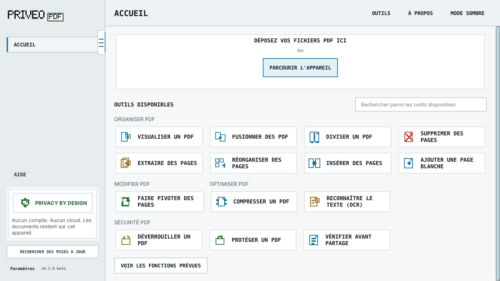
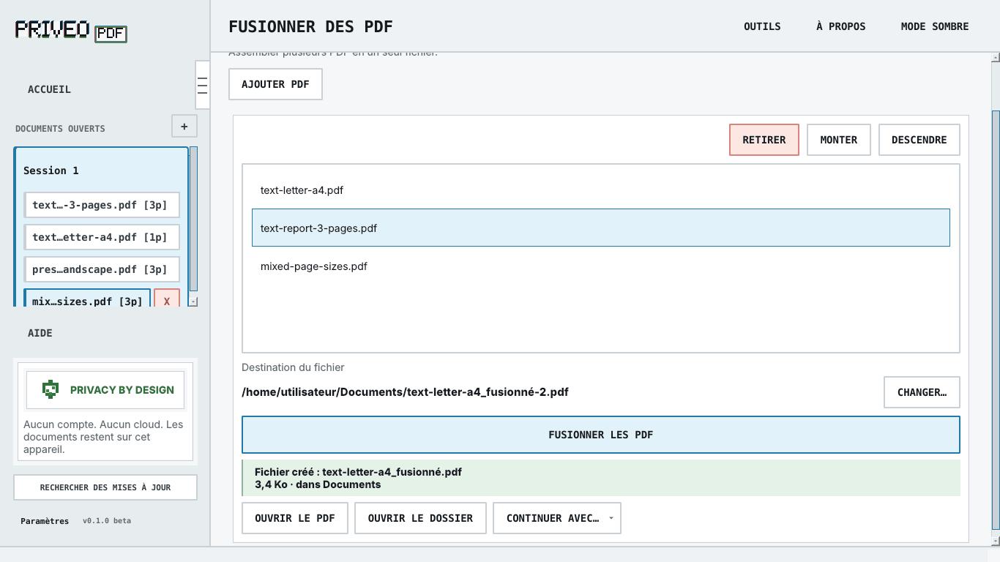

# PriveoPDF

**Your PDFs, processed on your computer.** PriveoPDF is a Linux desktop
application for viewing, organizing, compressing, protecting and recognizing
text in PDF files. No account, document upload or telemetry.



## Features

| Task | Tools |
| --- | --- |
| Read | Continuous scrolling, zoom, text selection, search and open documents |
| Organize | Merge, split, extract, remove, rotate, reorder, duplicate and insert pages; add blank pages |
| Optimize | Compress, with a before-and-after size comparison |
| Recognize text | Local OCR using installed Tesseract language models |
| Protect and share | Password protection, unlocking, metadata inspection and removal, image-only copies, redaction and text watermarks |

Each operation creates a new copy and preserves the original by default.
Redaction produces an image-only copy: the resulting text is not selectable.
General PDF editing, annotation, format conversion and digital signatures are
not available. Windows and macOS are not supported.



## Run from source

The public source snapshot includes the Linux launcher. You need Python 3.12 or
later, [uv](https://docs.astral.sh/uv/getting-started/installation/), the native
Qt libraries and working Bubblewrap isolation. See the
[source installation guide](docs/INSTALL_DEV.md) for prerequisites.

From the extracted or cloned project directory:

```bash
uv sync --frozen --dev
bash tools/launch_priveopdf.sh
```

Use the launcher for PDF processing: the Python entry point alone does not
prepare the required isolation. OCR and image rendering also require the
system facilities described in the installation guide.

The first installable `.deb` beta is still in preparation. Official packages,
when published, will appear in
[Releases](https://github.com/godlittleboi/PriveoPDF-public/releases).
The [package installation guide](docs/INSTALL_USER.md) describes that separate
route. Public source availability does not mean an installable beta has been
released or qualified on your computer.

## Privacy

PDF processing stays on your computer. The Linux launcher isolates the document
process from the network; it refuses to start when isolation is unavailable.
Optional update checks require consent and send no document, content or path.
Installing dependencies requires Internet access. See the
[network inventory](docs/compliance/NETWORK_ACTIVITY.md) for details.

## Help and feedback

- [User guide](docs/wiki/en/getting-started.md) · [Guide en français](docs/wiki/getting-started.md)
- [Discussions](https://github.com/godlittleboi/PriveoPDF-public/discussions): help, ideas and feedback.
- [Security policy](SECURITY.md): private vulnerability reporting.

Use synthetic examples and never attach a sensitive PDF. External code
contributions are not currently accepted; see [CONTRIBUTING.md](CONTRIBUTING.md).

## License and provenance

PriveoPDF is open source. Its own code and documentation are licensed under **Apache-2.0**
([LICENSE](LICENSE), [NOTICE](NOTICE)). Earlier publications retain their
original licenses. Third-party components retain their own licenses, including
Qt under LGPL; see [THIRD_PARTY_NOTICES.md](THIRD_PARTY_NOTICES.md).
The [name and logo](docs/legal/TRADEMARKS.md) are separate from the code license.

This repository contains selected source snapshots, without private development
history. `PUBLIC_SOURCE_MANIFEST.json` identifies the exact source commit,
generated files and exclusions; `SHA256SUMS` records file integrity. Private Git
updates and internal beta history are disabled in this snapshot.
