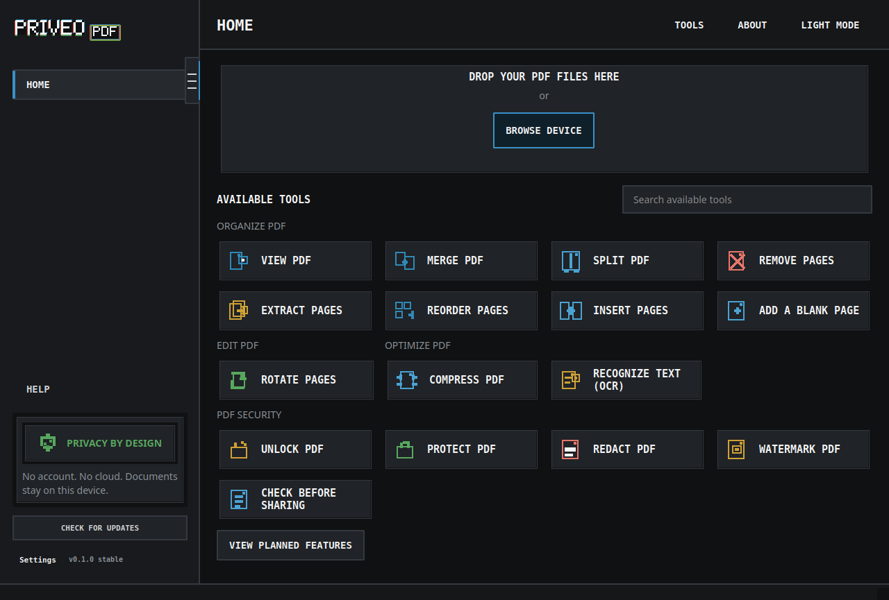
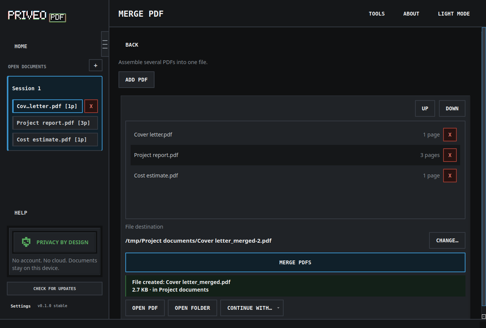

# PriveoPDF

PriveoPDF is an open source Linux app for reading, organizing and protecting PDFs. Your documents stay on your computer, and all PDF tools work offline without an account.

## Install on Linux

**[Download the latest stable PriveoPDF (.deb)](https://github.com/godlittleboi/PriveoPDF-public/releases/latest/download/priveopdf_amd64.deb)**

On **Linux Mint 22.x** or **Ubuntu 24.04** (64-bit Intel or AMD), double-click the downloaded file and follow the installation prompts. Then open **PriveoPDF** from the applications menu.

## What you can do

- **Read and organize.** Search for text, merge documents, split a PDF, or extract, reorder and rotate pages.
- **Make scans searchable.** Use local text recognition (OCR) with the languages installed on your computer.
- **Prepare a copy to share.** Compress a file, add a password or watermark, remove metadata, or redact sensitive areas.

PriveoPDF saves changes to a new file by default, so you keep the original.

## Guides and support

- [PDF tools guide](docs/wiki/en/features/README.md) · [Troubleshooting](docs/wiki/en/troubleshooting.md) · [Ask a question](https://github.com/godlittleboi/PriveoPDF-public/discussions)
- [Run from source](docs/INSTALL_DEV.md) if you cloned the repository or downloaded the source ZIP.
- [Verify the download](https://github.com/godlittleboi/PriveoPDF-public/releases/latest) using the signing key with fingerprint `34A3 6EB8 81F3 5C88 DA61 0396 0285 072F 74B3 80F2`.

## License

PriveoPDF's code and documentation use the [Apache 2.0 license](LICENSE). See the [third-party notices](THIRD_PARTY_NOTICES.md) for bundled components and the [trademark policy](docs/legal/TRADEMARKS.md) for the name and logo.
